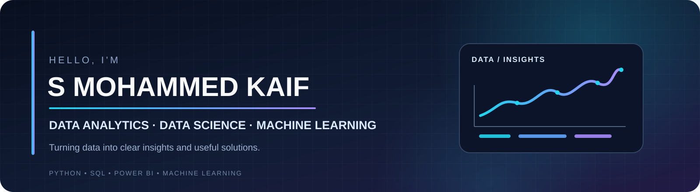
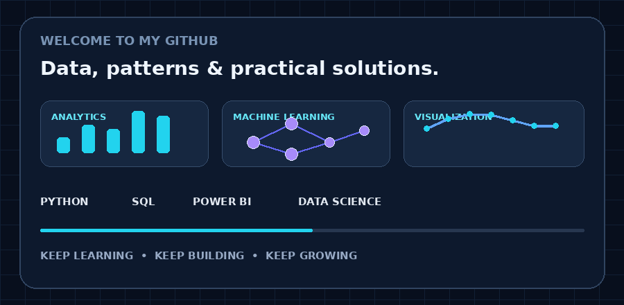
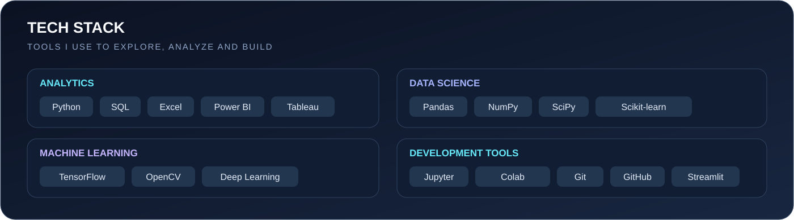

<!-- ================= PROFILE HEADER ================= -->

  

  

  

---

## 👨‍💻 About Me

- B.Tech background in Computer Science Engineering (Data Science).
- Interested in Data Analytics, Data Science, Business Intelligence and Machine Learning.
- I work with Python, SQL, data visualization and predictive modeling.
- I enjoy turning raw data into clear insights and practical solutions.

## 🧰 Tech Stack

  

---

## 📊 GitHub Stats

  
  

  

## 🏆 GitHub Trophies

  

## 📈 Contribution Activity

  

## ✍️ Developer Quote

  

---

  
    
  <b>💡 Turning Data into Insights, One Project at a Time.</b>
   
  Keep Learning • Keep Building • Keep Growing
    
  

