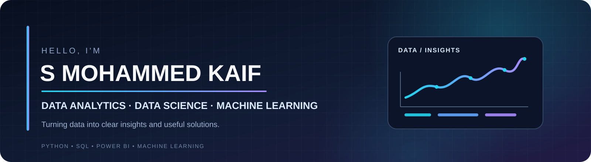
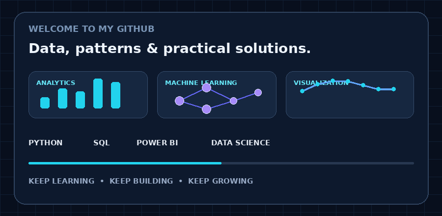
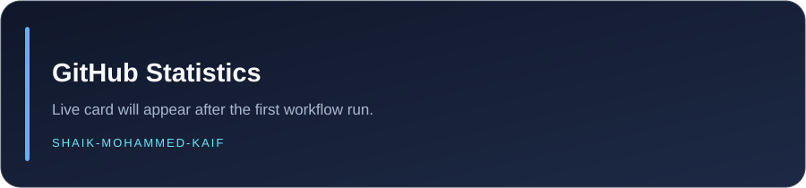

<!--
  S MOHAMMED KAIF | GITHUB PROFILE README
  Repository: Shaik-Mohammed-Kaif/Shaik-Mohammed-Kaif

  Animation strategy:
  - GIF files in ./assets/ provide reliable looping motion.
  - SVG files are used for static graphics and refreshed stat cards.
  - GitHub Actions refreshes the stored stat cards every 12 hours.
-->

  

  
  Typing animation inspiration: <a href="https://readme-typing-svg.demolab.com/demo/">Readme Typing SVG Demo</a>. This profile uses a repository-hosted GIF for dependable motion.

  

  
  
  
  

  
  
  

💫 About Me
Hi, I'm S Mohammed Kaif — a Computer Science Engineering student specializing in Data Science.

I enjoy turning raw data into useful insights through programming, statistics, exploratory data analysis, visualization and machine learning. My interests span the complete data workflow: collecting and cleaning data, exploring patterns, writing SQL queries, building dashboards and communicating findings clearly.
- 🎓 Education: B.Tech — Computer Science Engineering (Data Science)
- 🏫 Institution: St. John's College of Engineering and Technology, Yemmiganur
- 📅 Academic period: 2023–2026
- 📊 Primary interests: Data Analytics, Business Intelligence, Data Science and Machine Learning
- 🧠 Core toolkit: Python, SQL, Pandas, NumPy, Excel and Power BI
- 🌱 Currently strengthening: Advanced SQL, statistics, machine learning and deep learning
- 🤝 Collaboration: Practical analytics, Python, SQL, dashboarding and AI/ML projects
- 💬 Topics I enjoy: Data cleaning, EDA, data visualization, SQL problem-solving and analytics projects

  

🎯 Areas of Interest

  
  
  
  

🧰 Tech Stack & Tools
💻 Programming Languages

  
  
  

📊 Data Analysis & Statistics

  
  
  
  
  
  

📈 Business Intelligence & Data Visualization

  
  
  
  
  
  

🤖 Machine Learning & Computer Vision

  
  
  
  

🗄️ Databases

  
  
  
  

⚙️ Frameworks, IDEs & Developer Tools

  
  
  
  
  
  
  

🧩 Technology Icons

  

  

🚀 Featured Projects
Here are selected projects from my Data Analytics and Data Science portfolio.
#	Project	What it explores	Repository
01	YouTube Data Analytics	Video performance, engagement metrics and content insights	View project
02	Sales Analytics	Sales trends, business performance and actionable insights	View project
03	Customer Churn Analysis	Churn patterns, customer behaviour and retention analysis	View project
04	EV Market Intelligence	Electric vehicle market trends and analytical insights	View project
05	Web Intelligence — NLP Sentiment Analytics	Text analysis and sentiment insights from web content	View project

  

🎓 Education
Qualification	Institution	Period
B.Tech — Computer Science Engineering (Data Science)	St. John's College of Engineering and Technology, Yemmiganur	2023–2026

📜 Virtual Job Simulations — Forage
Selected virtual job simulations completed:
- BCG — Introduction to Data for Decision Makers
- DLA Piper — Global Cyber with Data Privacy
- Freshfields — Private Capital
- J.P. Morgan — Quantitative Research
📊 GitHub Statistics

  
  

  

Language statistics represent the language distribution of public repositories; they are not a measure of skill or proficiency.
🏆 GitHub Achievements

  

📈 Contribution Activity

  

✍️ Developer Quote

  

🤝 Let's Connect
I'm interested in connecting with people who work on data analytics, business intelligence, data science, Python, SQL and machine learning.

  
  
  
  

  <b>Turning data into insights — one query, one dashboard and one project at a time.</b>

🌟 Profile Inspiration
A couple of GitHub profiles I enjoy exploring:
- Abhizz-b
- SP-XD

  

  

<!--
  SETUP CHECKLIST
  1. Keep this README.md in the root of the profile repository.
  2. Keep the assets folder beside README.md (do not create assets/assets).
  3. Upload .github/workflows/update-profile-assets.yml.
  4. In GitHub: Settings > Actions > General > Workflow permissions >
     select "Read and write permissions".
  5. Run Actions > Update GitHub Profile Assets > Run workflow once.
-->
