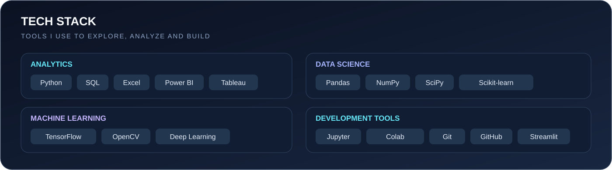

<!-- =========================================================
     S MOHAMMED KAIF | GITHUB PROFILE README
     Assets folder: ./assets/
     GitHub: Shaik-Mohammed-Kaif
========================================================== -->

<!-- ===================== HEADER ===================== -->

  

  

  

  
  
  

---

<!-- ===================== ABOUT ME ===================== -->

## 👨‍💻 About Me

Hello! I'm **S Mohammed Kaif**, a Computer Science Engineering professional with a specialization in Data Science.

I am interested in transforming raw data into meaningful insights through data analytics, statistical analysis, visualization, and machine learning.

- 🎓 **Education:** B.Tech in Computer Science Engineering (Data Science).
- 📊 **Interests:** Data Analytics, Data Science, Business Intelligence.
- 🧠 **Machine Learning:** Predictive Modeling, Model Evaluation and NLP.
- 🐍 **Programming:** Python, SQL and Java.
- 📈 **Visualization:** Power BI, Tableau, Matplotlib and Seaborn.
- 🔍 **Analytics:** Data Cleaning, EDA, Statistical Analysis and Reporting.
- 🛠️ **Development:** Streamlit, Flask and Data Applications.

I enjoy working on practical projects, exploring datasets, identifying patterns and communicating findings through visualizations and analytical solutions.

---

<!-- ===================== TECH STACK ===================== -->

## 🧰 Technical Skills & Tools

  

### Programming Languages

  
  
  

### Data Analysis & Manipulation

  
  
  
  

### Data Visualization & Business Intelligence

  
  
  
  
  

### Machine Learning & AI

  
  
  

### Databases & Development

  
  
  
  

### Tools & Platforms

  
  
  
  
  

---

<!-- ===================== PROJECTS ===================== -->

## 🚀 Featured Projects

Here are some selected projects from my data analytics and data science work.

### 1. YouTube Data Analytics

**Focus:** Data Analysis · Exploratory Data Analysis · Data Visualization

- Analyze YouTube-related datasets and identify meaningful patterns.
- Explore data distributions, trends and performance indicators.
- Present analytical findings through visualizations.

  

### 2. Sales Analytics Project

**Focus:** Business Analytics · Data Cleaning · Reporting

- Explore sales data to understand business performance.
- Analyze sales patterns and relevant business metrics.
- Support data-driven decision-making through analysis.

  

### 3. Customer Churn Analysis

**Focus:** Customer Analytics · Machine Learning · Predictive Analysis

- Explore customer data and churn-related patterns.
- Investigate factors associated with customer attrition.
- Apply analytical and machine learning techniques.

  

### 4. Electric Vehicle Market Intelligence

**Focus:** Market Analysis · Data Visualization · Business Intelligence

- Explore electric vehicle market information.
- Analyze market trends and relevant EV indicators.
- Communicate findings through analytical visualizations.

  

### 5. Web Intelligence – NLP-Based Sentiment Analytics

**Focus:** Natural Language Processing · Text Analytics · Sentiment Analysis

- Explore text data using NLP techniques.
- Analyze sentiment-related patterns in textual information.
- Transform unstructured text into useful analytical insights.

  

  

---

<!-- ===================== EDUCATION ===================== -->

## 🎓 Education

**B.Tech – Computer Science Engineering (Data Science)**

St. John's College of Engineering and Technology, Yemmiganur

2023 – 2026

---

<!-- ===================== CERTIFICATIONS ===================== -->

## 📜 Selected Virtual Job Simulations

Completed virtual job simulations through Forage, including:

- BCG – Introduction to Data for Decision Makers.
- DLA Piper – Global Cyber with Data Privacy.
- Freshfields – Private Capital.
- J.P. Morgan – Quantitative Research.

---

<!-- ===================== ANALYTICS ===================== -->

## 📊 GitHub Statistics

  
  

  

---

## 🏆 GitHub Trophies

  

---

## 📈 Contribution Activity

  

---

<!-- ===================== DEVELOPER QUOTE ===================== -->

## ✍️ Developer Quote

  

---

<!-- ===================== CONNECT ===================== -->

## 🤝 Let's Connect

I'm interested in connecting with people working in Data Analytics, Data Science, Machine Learning and Business Intelligence.

  
  
  

  <b>Open to learning opportunities, collaborations and meaningful projects.</b>

---

<!-- ===================== FOOTER ===================== -->

  

<h3 align="center">
  💡 Turning Data into Insights, One Project at a Time.
</h3>

  Keep Learning • Keep Building • Keep Growing

  

<!--
ASSET UPDATE:
GitHub Actions workflow:
.github/workflows/update-profile-assets.yml

The workflow refreshes locally stored GitHub statistics SVG cards.
Run it manually from the Actions tab or wait for the scheduled run.
-->
